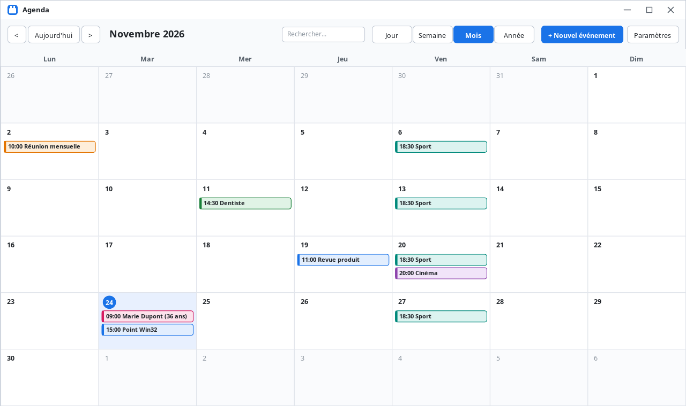
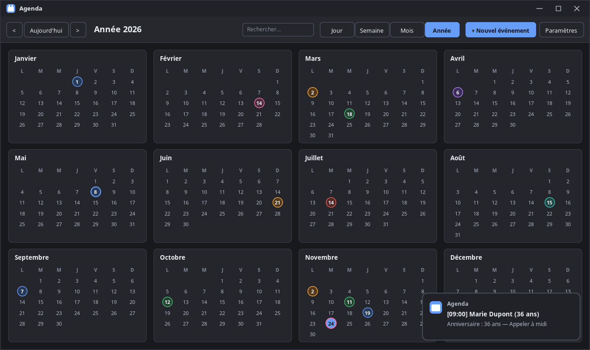
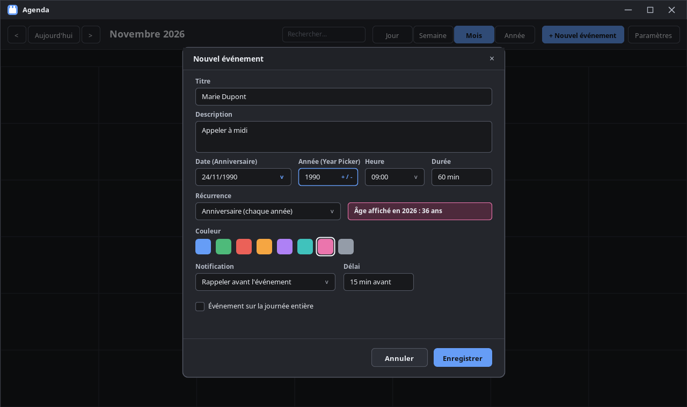

# OpenAgenda

**A fast, open-source, 100% local Windows calendar written in pure C (Win32 Unicode).**

OpenAgenda (`OpenAgenda.exe`) is built directly on native Windows APIs with **zero external dependencies**, **no embedded browser**, **no server**, and **no telemetry**. It launches instantaneously, respects your system Light/Dark theme, and keeps all your events in plain-text JSON files on your own disk.

> **[Download the latest release on GitHub Releases](../../releases)**

---

## Why OpenAgenda?

Modern desktop calendars—including the built-in Windows Calendar / New Outlook app—bundle heavy web runtimes (WebView2 / Chromium), require cloud accounts, run background sync services, and consume hundreds of megabytes of RAM just to remind you of an appointment.

OpenAgenda takes the opposite approach:

| | OpenAgenda | Built-in Windows Calendar / Web-based Apps |
| --- | --- | --- |
| **Runtime** | Pure C Win32 Unicode binary | WebView2 / UWP / web runtime |
| **External Dependencies** | None (standard Windows DLLs only) | Heavy runtime & background services |
| **Account & Server** | **100% local & offline** — no server needed | Cloud account & remote sync required |
| **Privacy & Telemetry** | **Zero** network calls, zero tracking | Telemetry, diagnostics & cloud storage |
| **Windows Registry** | **Zero** Registry writes (`agenda.ini`) | Extensive Registry footprint |
| **Data Format** | Human-readable `events.json` + snapshots | Proprietary local cache / remote DB |

---

## Screenshots

### Month View (Light Mode)
Clean native Win32 layout following Windows Light mode with keyword search, quick view switching, and automatic age calculation on birthdays.



### Year View & Native Tray Notification (Dark Mode)
4×3 Year overview with clickable colored event badges and native Windows tray notifications.



### Event Editor, Birthdays & Custom Pickers (Dark Mode)
Full dark-mode support across dialogs, custom Date Picker, Year Picker, Time Picker, 8 color swatches, and reminder rules.



---

## Privacy & Local-First Design

- **Offline by design:** OpenAgenda never opens a network socket and never communicates with any server.
- **Zero Registry clutter:** All settings (`DataFolder`, default view, custom font, tray behavior, reminder sound) are stored locally in `agenda.ini` next to the executable. Even "Start with Windows" uses a clean `.lnk` shortcut in the Windows Startup folder rather than Registry run keys.
- **You own your data:** Events are saved in a transparent, human-readable `events.json` file inside any folder you choose.
- **Automatic timestamped backups:** Every creation, edit, or deletion increments the version counter and archives a timestamped JSON snapshot in a `versions\` subfolder—making recovery trivial.

---

## Features

- **Four Interactive Views:** Switch seamlessly between **Day**, **Week** (hourly grid with current-time indicator and concurrent event lanes), **Month**, and **Year** (4×3 overview where clicking any marked day opens or edits events directly).
- **Flexible Recurrences & Birthdays:** Single events, daily, weekly (custom weekday mask), monthly by date, monthly by Nth weekday (e.g., *first Monday*), yearly, and **Birthday** mode with leap-year handling (`Feb 29`) and automatic age display in both the calendar and notifications.
- **Custom Themed Pickers:** Native dark/light-aware **Date Picker**, **Year Picker** (scroll wheel & keyboard support for quick birth-year selection), and **Time Picker**.
- **System Theme Sync:** Reads Windows Light/Dark preference (`AppsUseLightTheme`) and updates live on `WM_SETTINGCHANGE`, including dark title bars and all modal dialogs.
- **Custom Typography:** Choose your preferred application font family and size directly in Settings.
- **System Tray & Reminders:** Single-instance background tray icon (`Shell_NotifyIconW`), start-minimized & minimize-to-tray options, native toast/balloon reminders showing event descriptions, and optional custom `.wav` alert sounds.
- **Live Search:** Instant keyword filtering across event titles and descriptions.

---

## Download

Prebuilt Windows executables (`OpenAgenda.exe`) are available on the releases page:

**[Go to GitHub Releases](../../releases)**

1. Download the latest `OpenAgenda.exe` from **GitHub Releases**.
2. Place it in any folder (no installer required).
3. Launch `OpenAgenda.exe` and choose where you want your `events.json` stored.

---

## Building from Source (Optional)

OpenAgenda is open source and compiles cleanly with MinGW-w64 GCC (`mingw32-make`) with zero third-party libraries:

```bash
mingw32-make
```

This builds `OpenAgenda.exe` directly from `src/` with embedded Per-Monitor DPI v2 manifest, version info, and multi-resolution application icon (`src/agenda.ico`).

---

## Repository Structure

```text
├── src/            # Pure C Win32 Unicode source files, headers, manifest, and icon
├── screenshots/    # Application screenshots (Light & Dark modes)
├── pages/          # Multilingual static showcase site (GitHub Pages)
└── Makefile        # MinGW-w64 build configuration
```
